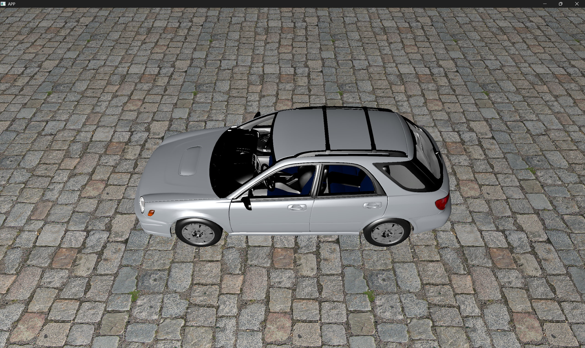

## Platforms

| OS      | Window system | Status  |
|---------|---------------|---------|
| Windows | Win32         | ✅       |
| Linux   | X11, Wayland  | ✅       |
| macOS   | —             | planned |

## Requirements

- CMake ≥ 4.2
- Conan 2
- C++23 compiler: GCC 14+ (MinGW-w64 on Windows)
- Vulkan SDK 1.4 with `slangc`
- GPU with Vulkan 1.3 support
- **Linux only:** X11 and Wayland development headers
  (e.g. `libx11-dev libwayland-dev` on Debian/Ubuntu,
  `libX11-devel wayland-devel` on Fedora)
